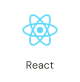
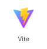
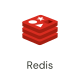
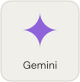
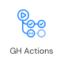
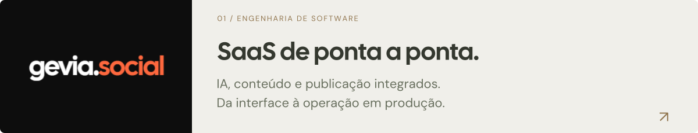
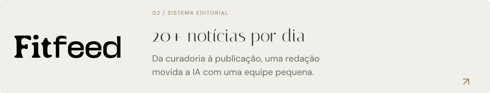

<a href="https://ofelipemart.gevia.co">
  <picture>
    <source media="(max-width: 600px) and (prefers-color-scheme: dark)" srcset="assets/header-mobile-dark.svg">
    <source media="(max-width: 600px)" srcset="assets/header-mobile-light.svg">
    <source media="(prefers-color-scheme: dark)" srcset="assets/header-dark.svg">
    
  </picture>
</a>

  <a href="https://ofelipemart.gevia.co">Portfólio ↗</a> &nbsp; · &nbsp;
  <a href="https://www.linkedin.com/in/felipe-bittar-martiniano/">LinkedIn</a> &nbsp; · &nbsp;
  <a href="mailto:felipebittarmartiniano@gmail.com">E-mail</a>

### Engenheiro de software full stack

Sou o Felipe. Desenvolvo e mantenho produtos digitais de ponta a ponta, da interface à infraestrutura, com foco em IA aplicada e automação.

Minha experiência em redes sociais conecta engenharia à rotina de conteúdo: briefing, identidade visual, criação, calendário, métricas e publicação, com projetos para marcas, portais de notícias e agências.

### O que construo e sustento

- **Produto full stack:** interfaces e editores em React e TypeScript, APIs em Node.js e Express.
- **IA aplicada:** pipelines de geração, integração de modelos, validação de respostas e controle de custos.
- **Dados e integrações:** Supabase e PostgreSQL, isolamento de clientes, OAuth, publicação e pagamentos.
- **Operação de SaaS:** filas com BullMQ e Redis, processamento de mídia, Docker, CI/CD e monitoramento.

### Stack

**Produto**

  &nbsp;
  &nbsp;
  &nbsp;
  &nbsp;
  &nbsp;
  

**Dados e IA**

  &nbsp;
  &nbsp;
  &nbsp;
  &nbsp;
  

**Operação e qualidade**

  &nbsp;
  &nbsp;
  &nbsp;
  

### Alguns trabalhos

<a href="https://social.gevia.co">
  <picture>
    <source media="(max-width: 600px) and (prefers-color-scheme: dark)" srcset="assets/project-gevia-brand-v2-mobile-dark.svg">
    <source media="(max-width: 600px)" srcset="assets/project-gevia-brand-v2-mobile-light.svg">
    <source media="(prefers-color-scheme: dark)" srcset="assets/project-gevia-brand-v2-dark.svg">
    
  </picture>
</a>

**Content Chisel · Gevia Social** — Atuei no desenvolvimento e na sustentação técnica de um SaaS para redes sociais, integrando editor visual, geração com IA, publicação automática, assinaturas e créditos. Assumi a manutenção da operação, incluindo recuperação de tarefas, integrações com a Meta, monitoramento e custos de processamento.

<a href="https://ofelipemart.gevia.co/#trabalhos">
  <picture>
    <source media="(max-width: 600px) and (prefers-color-scheme: dark)" srcset="assets/project-fitfeed-brand-v2-mobile-dark.svg">
    <source media="(max-width: 600px)" srcset="assets/project-fitfeed-brand-v2-mobile-light.svg">
    <source media="(prefers-color-scheme: dark)" srcset="assets/project-fitfeed-brand-v2-dark.svg">
    
  </picture>
</a>

<a href="https://ofelipemart.gevia.co/#trabalhos">
  <picture>
    <source media="(max-width: 600px) and (prefers-color-scheme: dark)" srcset="assets/project-tv1-brand-mobile-dark.svg">
    <source media="(max-width: 600px)" srcset="assets/project-tv1-brand-mobile-light.svg">
    <source media="(prefers-color-scheme: dark)" srcset="assets/project-tv1-brand-dark.svg">
    
  </picture>
</a>

---

O pequeno escultor no topo veio do meu **[ateliê interativo](https://ofelipemart.gevia.co)**: um portfólio de mármore e bronze, com animação, jogos e um trabalho sempre em processo.

  <a href="https://www.linkedin.com/in/felipe-bittar-martiniano/">LinkedIn</a> &nbsp; · &nbsp;
  <a href="https://www.instagram.com/ofelipemart/">Instagram</a> &nbsp; · &nbsp;
  <a href="https://www.youtube.com/@ofelipemart">YouTube</a> &nbsp; · &nbsp;
  <a href="mailto:felipebittarmartiniano@gmail.com">Vamos conversar ↗</a>

