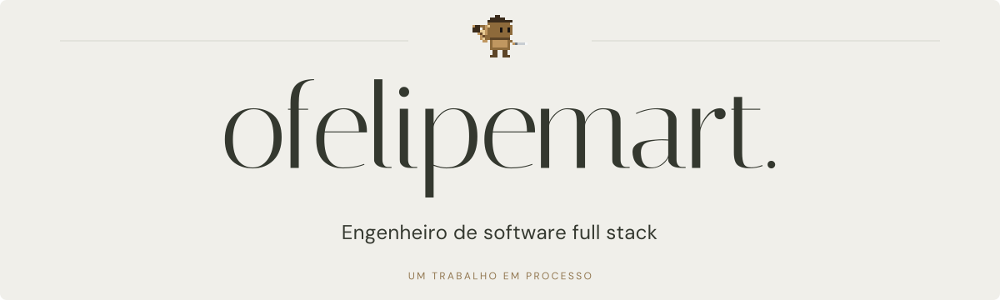
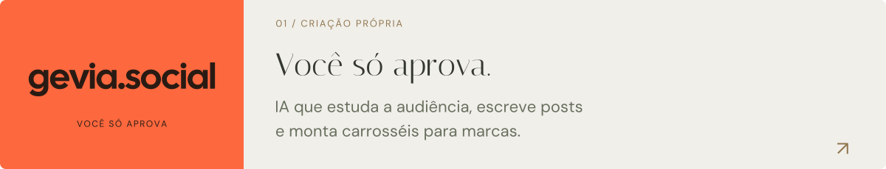
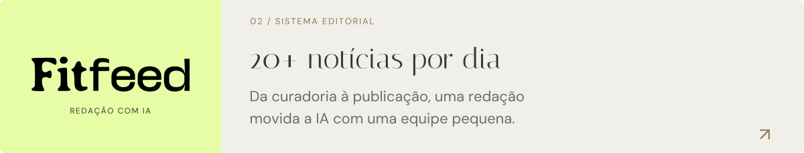

<a href="https://ofelipemart.gevia.co">
  <picture>
    <source media="(max-width: 600px) and (prefers-color-scheme: dark)" srcset="assets/header-mobile-dark.svg">
    <source media="(max-width: 600px)" srcset="assets/header-mobile-light.svg">
    <source media="(prefers-color-scheme: dark)" srcset="assets/header-dark.svg">
    
  </picture>
</a>

  <a href="https://ofelipemart.gevia.co">Portfólio ↗</a> &nbsp; · &nbsp;
  <a href="https://www.linkedin.com/in/felipe-bittar-martiniano/">LinkedIn</a> &nbsp; · &nbsp;
  <a href="mailto:felipebittarmartiniano@gmail.com">E-mail</a>

### Sou o Felipe, fundador da [gevia.social](https://social.gevia.co).

Ajudo marcas a crescer nas redes com IA que cria o conteúdo. Construo os produtos de ponta a ponta, da interface aos sistemas de automação.

### Alguns trabalhos

<a href="https://social.gevia.co">
  <picture>
    <source media="(max-width: 600px) and (prefers-color-scheme: dark)" srcset="assets/project-gevia-mobile-dark.svg">
    <source media="(max-width: 600px)" srcset="assets/project-gevia-mobile-light.svg">
    <source media="(prefers-color-scheme: dark)" srcset="assets/project-gevia-dark.svg">
    
  </picture>
</a>

<a href="https://ofelipemart.gevia.co/#trabalhos">
  <picture>
    <source media="(max-width: 600px) and (prefers-color-scheme: dark)" srcset="assets/project-fitfeed-mobile-dark.svg">
    <source media="(max-width: 600px)" srcset="assets/project-fitfeed-mobile-light.svg">
    <source media="(prefers-color-scheme: dark)" srcset="assets/project-fitfeed-dark.svg">
    
  </picture>
</a>

<a href="https://ofelipemart.gevia.co/#trabalhos">
  <picture>
    <source media="(max-width: 600px) and (prefers-color-scheme: dark)" srcset="assets/project-tv1-mobile-dark.svg">
    <source media="(max-width: 600px)" srcset="assets/project-tv1-mobile-light.svg">
    <source media="(prefers-color-scheme: dark)" srcset="assets/project-tv1-dark.svg">
    
  </picture>
</a>

### Por trás das interfaces

**[image-gen-nextjs ↗](https://github.com/feBittar/image-gen-nextjs)** — Editor de layouts, templates e carrosséis, com prévia e exportação de imagens. 
Next.js · React · TypeScript

**[carousel-api ↗](https://github.com/feBittar/carousel-api)** — API para compor slides, renderizar imagens e publicar no Google Cloud Storage. 
Node.js · Express · TypeScript · Puppeteer

---

O pequeno escultor no topo veio do meu **[ateliê interativo](https://ofelipemart.gevia.co)**: um portfólio de mármore e bronze, com animação, jogos e um trabalho sempre em processo.

  <a href="https://www.linkedin.com/in/felipe-bittar-martiniano/">LinkedIn</a> &nbsp; · &nbsp;
  <a href="https://www.instagram.com/ofelipemart/">Instagram</a> &nbsp; · &nbsp;
  <a href="https://www.youtube.com/@ofelipemart">YouTube</a> &nbsp; · &nbsp;
  <a href="mailto:felipebittarmartiniano@gmail.com">Vamos conversar ↗</a>

