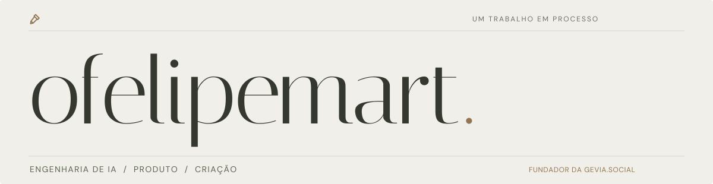

 

### Olá, sou o Felipe.

**Engenheiro de IA fullstack e fundador da [gevia.social](https://social.gevia.co).**

Ajudo marcas a crescer nas redes com IA que cria o conteúdo. Construo produtos que conectam inteligência artificial, automação e experiências digitais — da ideia à aplicação em uso.

Meu trabalho passa por criação de conteúdo, sistemas editoriais e ferramentas para equipes criativas. Gosto de dar forma a problemas complexos e transformar o que a IA permite em algo útil.

**[Explore meu portfólio ↗](https://ofelipemart.gevia.co)**

 

### Trabalhos selecionados

| Projeto | O que construí | Na prática |
| :--- | :--- | :--- |
| **[gevia.social ↗](https://social.gevia.co)** | Uma plataforma que estuda a audiência, escreve posts e monta carrosséis para marcas. | O conteúdo chega pronto; você decide o que vai ao ar. |
| **Fitfeed** | Uma máquina de IA para um portal de bem-estar, da curadoria das pautas à publicação das matérias. | **Mais de 20 notícias por dia**, com uma equipe pequena. |
| **Livelabs · Grupo TV1** | Na X.lab, uma plataforma interna para preparar o material de concorrência das agências: estratégia, criativo, briefing e imagens. | Um trabalho que levava cerca de um mês passou a ser entregue em **3 a 5 dias**, com uma equipe menor. |

Histórias e contexto de cada projeto no <a href="https://ofelipemart.gevia.co/#trabalhos">portfólio</a>.

### O que você encontra por aqui

**IA aplicada** · Produtos com IA generativa, criação de conteúdo e automação de processos.

**Engenharia fullstack** · Interfaces, APIs e integrações que fazem o produto funcionar de ponta a ponta.

**Experiências interativas** · Experimentos em JavaScript, interfaces e jogos — incluindo o ateliê interativo do meu portfólio.

### Código aberto

- **[image-gen-nextjs](https://github.com/feBittar/image-gen-nextjs)** — Editor de layouts, templates e carrosséis com Next.js, React e TypeScript.
- **[carousel-api](https://github.com/feBittar/carousel-api)** — API em TypeScript e Express para compor slides, renderizar imagens com Puppeteer e publicar no Google Cloud Storage.

### Vamos conversar

[Portfólio](https://ofelipemart.gevia.co) · [LinkedIn](https://www.linkedin.com/in/felipe-bittar-martiniano/) · [Instagram](https://www.instagram.com/ofelipemart/) · [YouTube](https://www.youtube.com/@ofelipemart) · [E-mail](mailto:felipebittarmartiniano@gmail.com)

---

Um trabalho em processo. Golpe a golpe.
